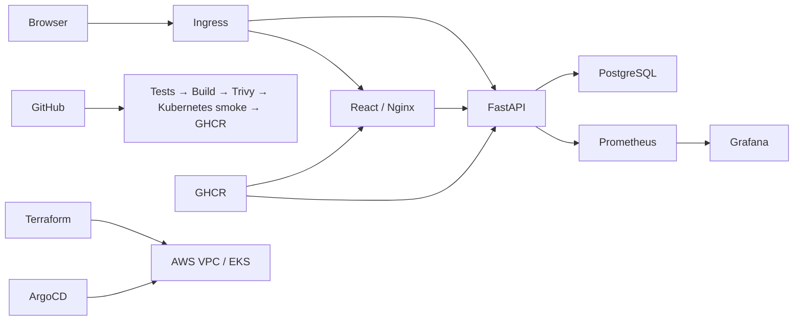

# ResolveDesk

ResolveDesk is a helpdesk workspace for recording, assigning and resolving support tickets. It is an original application built for the DevSecOps capstone, using [the supplied TaskBoard repository](https://github.com/Nency-Ravaliya/devsecops-python) as an infrastructure starting point. The original assignment is preserved in [docs/assignment](docs/assignment/).

## Application

Each ticket has a requester email, subject, description, priority, assignee and status. The React interface supports creation, editing, deletion with confirmation, search, status queues and pagination. FastAPI validates input and stores tickets in PostgreSQL through SQLAlchemy. Alembic owns schema changes.



The stack is Python 3.12, FastAPI, SQLAlchemy, Alembic, PostgreSQL 16, React, Vite, Nginx, Docker Compose, GitHub Actions, Trivy, GHCR, Terraform, AWS EKS, Helm, ArgoCD, Prometheus and Grafana.

## Local setup

Install Docker with Compose, then run:

```sh
docker compose up --build -d
```

Open http://localhost:3000. API documentation is at http://localhost:8000/docs. Compose waits for PostgreSQL health, runs migrations, starts the backend and then starts the frontend. Both application images run as non-root users. Local database credentials are for this isolated demonstration only; the database port is not published.

```sh
python3 scripts/smoke-api.py --base-url http://localhost:8000
docker compose ps
docker compose down
```

`docker compose down -v` also deletes local ticket data. Do not use it if that data must be retained.

For development without application containers, install Python 3.12+ and Node 22+, provide a PostgreSQL `DATABASE_URL`, then:

```sh
cd backend
python3 -m venv .venv
source .venv/bin/activate
pip install -r requirements-dev.txt
alembic upgrade head
uvicorn app.main:app --reload --port 8000
```

In another terminal:

```sh
cd frontend
npm ci
npm run dev
```

The Vite development server proxies `/api` to localhost:8000.

## Tests and API

```sh
cd backend
pytest -v
```

Tests use an isolated in-memory SQLite database, never the runtime PostgreSQL database. The HTTP smoke script separately exercises the running PostgreSQL-backed service and removes only the synthetic ticket it creates.

```sh
npm ci --prefix frontend
npm test --prefix frontend
npm run build --prefix frontend
```

| Method | Route | Purpose |
|---|---|---|
| GET | `/api/tickets` | Search, filter and paginate tickets |
| POST | `/api/tickets` | Create a validated ticket |
| GET | `/api/tickets/{id}` | Read one ticket |
| PUT / PATCH | `/api/tickets/{id}` | Update supplied ticket fields |
| DELETE | `/api/tickets/{id}` | Delete a ticket |
| GET | `/api/tickets/stats` | Queue counts and unresolved urgent count |
| GET | `/health` | Process liveness |
| GET | `/ready` | Database readiness, 503 on failure |
| GET | `/metrics` | Prometheus metrics |

Statuses are `OPEN`, `IN_PROGRESS`, `RESOLVED`; priorities are `LOW`, `MEDIUM`, `HIGH`, `URGENT`. Blank subjects, invalid email addresses, unknown enum values and explicit null updates are rejected. Search treats SQL wildcard characters literally.

## CI and security

[GitHub Actions](https://github.com/dibyo10/resolvedesk-devsecops/actions) runs on pushes and pull requests to main. It runs backend and frontend tests and builds the frontend before building either image. The same built images are scanned by Trivy, loaded into a temporary Kind cluster, deployed using Helm and smoke tested. Only successful main-branch runs publish images to GHCR with the full Git commit SHA as the tag.

Trivy scans operating-system and application dependencies in both runtime images. HIGH or CRITICAL findings fail the job, including findings without fixes. A clean scan means no matching vulnerabilities were found in that database snapshot; it does not establish that the application is free from all security flaws. Reports are retained as workflow artifacts.

Application and scanner base images are digest pinned. Python dependencies and npm packages are locked. GitHub's scoped token publishes containers; registry credentials are not stored in the repository.

## AWS infrastructure

See [terraform/README.md](terraform/README.md) for setup, plan, apply and destroy. Terraform provisions a VPC, two public and two private subnets, EKS, managed worker nodes, and EBS CSI permissions. The temporary worker nodes use public subnets and automatically assigned public IPs because the account has exhausted its Elastic IP quota. Node security groups allow no public inbound traffic, and the Kubernetes API is restricted to the operator's explicit IP range. No NAT gateway or existing Elastic IP is used. The example uses ap-south-1.

AWS infrastructure costs money while it exists. The capstone deployment is temporary; its final creation and teardown evidence is recorded in [demo](demo/). Terraform state, saved plans, credentials and real variable files must remain local.

## Kubernetes and GitOps

See [helm/resolvedesk/README.md](helm/resolvedesk/README.md). Supply a Kubernetes database Secret before installation, configure the published image SHA, then deploy the chart. The chart includes two backend and two frontend replicas, ClusterIP Services, a persistent PostgreSQL StatefulSet, a migration Job, readiness/liveness probes, CPU-based HPA and optional Ingress and ServiceMonitor.

Migrations run in one Job per image version; backend replicas wait for the expected schema revision. Nginx and ingress route `/api` to the backend. No internal hostname is exposed to browser JavaScript.

[The ArgoCD Application](k8s/argocd-application.yaml) tracks the Helm chart and its release values from this repository. CI validates and publishes; ArgoCD reconciles the explicitly selected image SHA in Git. Updating [values-release.yaml](helm/resolvedesk/values-release.yaml) promotes a verified image. A Git revert provides a reviewable rollback of the desired deployment version.

## Monitoring and troubleshooting

See [monitoring/README.md](monitoring/README.md). Prometheus discovers the backend through a ServiceMonitor. The Grafana dashboard displays request rate, latency and server errors from live backend metrics. Metrics Server supplies HPA CPU measurements; low traffic alone does not prove autoscaling.

The deliberately broken manifests in [troubleshooting](troubleshooting/) demonstrate an invalid image and a mismatched Service selector. Use a separate lab namespace, inspect pod events and service endpoints, fix the relevant field, and remove the lab resources afterward.

## Scope and evidence

This is an internal classroom demonstration, not a public customer service. It has no authentication, tenant isolation, email delivery, backups or HA database. Use synthetic data and local port forwards. PostgreSQL in Kubernetes is suitable for this exercise; a managed database and access controls would be required before public deployment.

See [demo/README.md](demo/README.md) for the evidence index, slide deck, walkthrough and verified results, teardown audit and documented limitations. Reference history is retained, and original project commits describe the meaningful helpdesk changes.
